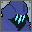

 
# Val2d 
*An attempt at recreating all of VALORANT in 2 dimensions*

## Play (current build)

```bash
pip install -r requirements.txt
python play.py                 # main menu: practice vs bots, host LAN or online, join, settings
python server.py --online      # dedicated server with a join code (LAN without --online)
python map_editor.py alley     # map editor for gameplay/data/maps/*.json
```

Controls: WASD run · Shift walk · Ctrl crouch · Space jump · mouse turn and aim depth · left click fire · right click
alternate fire (aim down sights, sniper scope, burst, spread shot, heavy knife stab, spin-up) · R reload · 1/2/3 weapons ·
C/Q/E/X abilities · hold F1 ability info · F plant/defuse, doors, swap weapons · G drop bomb/weapon · B buy menu ·
Tab scoreboard · Esc pause menu (in menus: closes the open page) · Alt+F4 quit (asks; a second Alt+F4 quits at once).

All settings and game values: [config/README.md](config/README.md).
Content: 30 agents in `config/content/agents/` (one file each), 20 weapons in `config/content/weapons.py`, maps Werkhof, Gasse and
Harbour plus a practice range (`python play.py --range`), materials, objects and decals in `config/content/materials.py`.
Own agents, abilities, statuses, mechanics and maps: [docs/MODDING.md](docs/MODDING.md).
Tests: `python -m pytest tests`.

## Status (12.11.2026)
- [x] Unrated match: buy phase, rounds, side switch, overtime, bomb (plant, defuse, detonation), economy
- [x] Gunplay: spread, spray pattern, 2D hit zones, wall penetration by material, alternate fire
- [x] 30 agents; ability kit with triggers, effects and passives, 21 presets, 19 statuses (docs/MODDING.md)
- [x] 3 maps + practice range, map editor (`map_editor.py`)
- [x] Bots with path finding and simple team tactics
- [x] LAN and internet play via netplay (join code), dedicated server, client prediction
- [x] Main menu with agent page, settings, pause menu, HUD at the bottom, round minimap with noise circle,
      sight area with occlusion, sniper scope, scoreboard with ping, spectating
- [ ] Played with a window and balanced
- [x] Own sound effects; modes quick and team deathmatch; rejoin; team buy; aim preview
- [x] Windows build with self test: `python build.py` → `dist/Val2d/Val2d.exe`
- [ ] Internet tested across two real networks

Detailed list: [roadmap.md](roadmap.md). The section below is the original plan from before the gameplay core and is kept as it was.

## Old roadmap (before the gameplay core)
### Available content at the time
### Game
#### Game Modes
- [ ] Range
- [ ] Unrated
- [ ] Competetive
- [ ] Escalation
- [ ] Spike Rush
#### Maps
- [ ] Bind
- [ ] Haven
- [ ] Split
- [ ] Ascent
- [ ] Icebox
- [ ] Breeze
- [ ] Fracture
- [ ] Pearl
- [ ] Lotus
- [ ] Sunset
- [ ] Abyss
#### Agents
- [ ]  Brimstone
- [ ]  Viper
- [ ]  Omen
- [ ]  Killjoy
- [ ]  Cypher
- [ ]  Sova
- [ ]  Sage
- [ ]  Phoenix
- [ ]  Jett
- [ ]  Reyna
- [ ]  Raze
- [ ]  Breach
- [ ]  Skye
- [ ]  Yoru
- [ ]  Astra
- [ ]  Kayo
- [ ]  Chamber
- [ ]  Neon
- [ ]  Fade
- [ ]  Harbor
- [ ]  Gekko
- [ ]  Deadlock
- [ ]  Iso
- [ ]  Clove
- [ ]  Vyse
- [ ]  Tejo
- [ ]  Waylay
#### Weapons
##### Melee
- [ ]  Melee
##### Sidearms
- [ ]  Classic
- [ ] Shorty
- [ ] Frenzy
- [ ] Ghost
- [ ] Sheriff
##### Primaries
- [ ] Stinger
- [ ] Spectre
- [ ] Bucky
- [ ] Judge
- [ ] Bulldog
- [ ] Guardian
- [ ] Phantom
- [ ] Vandal
- [ ] Marshall
- [ ] Outlaw
- [ ] Operator
- [ ] Ares
- [ ] Odin
#### Shield
- [ ] Light Shield
- [ ] Regen Shield
- [ ] Heavy Shield

### Menu
- [ ] Button Hovering
- [ ] Start
- [ ] Choose Join IP and Port
- [ ] Practice
- [ ] Shop

### Miscellaneous
- [ ] Lobby
- [ ] Multiplayer
- [ ] Shooting
- [ ] Planting
- [ ] Scoping
- [ ] Wall Penetration
- [ ] Sneaking
- [ ] Jumping
- [ ] Skins