# Val2d

A non-commercial, top-down 2D recreation of VALORANT for solo practice against bots and private matches with friends.

The content and roadmap below track the development build. Gameplay changes may land on this branch separately.

[Maps](#maps) · [Agents](#agents) · [Weapons and armor](#weapons-and-armor) · [Roadmap](#roadmap)

## Play

```sh
python -m pip install -r requirements.txt
python play.py
python play.py --no-menu --map ascent --team-size 5
python server.py --online
python map_editor.py ascent
```

Use the main menu to play Unrated, Swiftplay or Team Deathmatch against bots, or choose Custom to host or join a private match. Join over LAN by address or discovery, or over the internet with a join code. Run `python play.py --help` or `python server.py --help` for command-line options.

| Controls | Action |
| --- | --- |
| WASD, Shift, Ctrl, Space | Run, walk, crouch, jump |
| Mouse, left click, right click | Turn and aim depth, fire, alternate fire or cancel an aimed ability |
| R, 1 / 2 / 3 | Reload, switch weapons |
| C / Q / E / X, hold F1 | Abilities, ability info |
| F, G | Interact, plant or defuse, swap weapons with F. Drop the bomb or weapon with G. |
| B, Tab, Esc | Buy menu, scoreboard, pause or close the current menu |
| Alt+F4 | Open quit confirmation. Press again to quit immediately. |

## Game content

<!-- BEGIN GAME CONTENT -->

### Maps

| Icon | Map | Availability |
| --- | --- | --- |
| 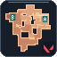 | Ascent | Default |
| 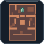 | Alley | Map editor |
| 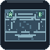 | Harbour | Map editor |
| 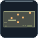 | Range | Map editor |
| 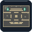 | Workyard | Map editor |

### Agents

8 selectable in the current build.

| Portrait | In game | Agent | Role | C / Q / E / X |
| --- | --- | --- | --- | --- |
| 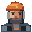 | 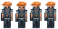 | Brimstone | Controller |     |
| 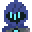 | 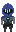 | Omen | Controller |     |
| 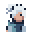 | 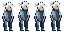 | Jett | Duelist |    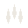 |
|  | 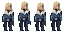 | Sova | Initiator |     |
| 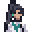 | 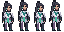 | Sage | Sentinel |     |
| 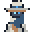 | 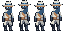 | Cypher | Sentinel |     |
| 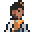 | 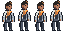 | Phoenix | Duelist |     |
| 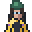 | 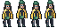 | Killjoy | Sentinel |     |

### Weapons and armor

21 configured weapons, including melee.

| Category | Item | Sprite | Cost |
| --- | --- | --- | --- |
| Melee | Tactical Knife |  | Starting loadout |
| Sidearm | Classic |  | Free |
| Sidearm | Shorty |  | 300 credits |
| Sidearm | Frenzy |  | 450 credits |
| Sidearm | Ghost |  | 500 credits |
| Sidearm | Bandit |  | 600 credits |
| Sidearm | Sheriff |  | 800 credits |
| SMG | Stinger |  | 1,100 credits |
| SMG | Spectre |  | 1,600 credits |
| Shotgun | Bucky |  | 850 credits |
| Shotgun | Judge |  | 1,850 credits |
| Rifle | Bulldog |  | 2,050 credits |
| Rifle | Guardian |  | 2,250 credits |
| Rifle | Phantom |  | 2,900 credits |
| Rifle | Vandal |  | 2,900 credits |
| Rifle | Warden |  | 2,900 credits |
| Sniper | Marshal |  | 950 credits |
| Sniper | Outlaw |  | 2,400 credits |
| Sniper | Operator |  | 4,700 credits |
| Heavy | Ares |  | 1,600 credits |
| Heavy | Odin |  | 3,200 credits |
| Armor | Light Armor |  | 400 credits |
| Armor | Heavy Armor |  | 1,000 credits |

<!-- END GAME CONTENT -->

## Roadmap

- [ ] Playtest Ascent with a full lobby and verify heights, windows, props and destructible cover. [Ascent design notes](docs/design/ASCENT.md)
- [ ] Verify ability animations and FX in a match for every active agent.
- [ ] Add rear and side character sprites for the active agents. [Figure views](docs/design/FIGURE_VIEWS.md)
- [ ] Check weapon sprites in hand, in the HUD and in the buy menu during a match.
- [ ] Tune gameplay and bot balance. Check the defender advantage on Harbour and the attacker advantage in Alley 1v1.
- [ ] Verify internet play across two separate networks.

See the [detailed roadmap](roadmap.md) and [sprite handover](docs/SPRITES.md).

## Development

- [Configuration](config/README.md) and [modding guide](docs/MODDING.md)
- In a checkout with the README generator, run `python -m tools.update_readme` after changing the roster, maps, weapons or sprites.
- Run the tests with `python -m pytest tests`.
- Build for Windows with `python build.py`. The game executable is `dist/Val2d/Val2d.exe`.

The VALORANT mark is by Riot Games. [VALORANT Asset Kit](https://playvalorant.com/en-gb/news/game-updates/valorant-asset-kit/)
