# Val2d

A non-commercial, top-down 2D recreation of VALORANT for solo practice against bots and private matches with friends.

The content and roadmap below track the development build. Gameplay changes may land on this branch separately.

[Maps](#maps) · [Agents](#agents) · [Weapons and armor](#weapons-and-armor) · [Roadmap](#roadmap)

## Play

```sh
python -m pip install -r requirements.txt
python play.py
python play.py --no-menu --map ascent --team-size 5
python server.py --online
python map_editor.py ascent
```

Use the main menu to play Unrated, Swiftplay or Team Deathmatch against bots, or choose Custom to host or join a private party. The host can copy the IP address or join code from the lobby. Guests can paste it into the join field, which remembers the last successful connection. After the match, **Return to party lobby** brings everyone back on the same connection. The host can change the mode, map and rules before starting the next match. Run `python play.py --help` or `python server.py --help` for command-line options.

In Team Deathmatch, press **B** in your team's spawn to choose a loadout for each of the four timed stages. The first team to 100 kills wins. At the end of stage four, the higher score wins and a tie is a draw.

With **Allow cheats** enabled, the host can pause or resume the countdown and end preparation or the current stage from the pause menu. Gameplay continues while the countdown is paused. Ending the final stage resolves the match using its current score. During live play, each player can toggle **Ghost** from the pause menu to fly through walls. Hold jump to rise and crouch to descend.

At each stage change, press **B** outside spawn to equip your next loadout immediately. Val2D gives you five seconds before the automatic switch. If you carry a station weapon, you can keep it by letting the timer expire. Respawning equips the current stage's loadout immediately.

Press **F** near a weapon on the map to take it from its station. Station weapons have limited ammo. Press **G** while using one to switch back to your loadout. You can also carry it into the next stage and use up its remaining ammo.

Walk over a recovery orb when you are missing health or shield. It restores both over six seconds. Teammates who enter the zone share the remaining recovery time. Each orb returns after 30 seconds.

Walk over an ultimate orb to gain up to 10 ultimate points. Each teammate who enters its zone during the next six seconds also gains the points once, up to their ultimate cost. In Val2D, both orbs appear together 60 seconds into live play and refill together every 60 seconds.

After respawning, leave your team's spawn within 15 seconds. You are protected from damage and enemy abilities until you leave or the timer expires. In Val2D, staying past the timer costs 10 HP per second.

Aim at one of your recallable devices and press **F**. In Team Deathmatch, a successful recall returns its charge after five seconds.

Open Bind or Haven with `python map_editor.py bind` or `python map_editor.py haven`. Both have buy barriers, elevated A Towers and walkable routes from each spawn to every plant site. Bind has two one-way player teleporters. Haven has a lower floor under A Tower and destructible metal plates on the Garage doors. Elevations and cover in the other areas still need a detailed pass. [Map references](https://playvalorant.com/en-us/maps/)

Recorded footsteps, rifle fire, magazine handling, Spike pulses and menu clicks use the [CC0 sound sources](assets/sounds/cc0/SOURCES.md).

Open **Inventory**, choose a weapon and preview a skin, then select **Equip** to save it. Every weapon has a Standard look and at least one variant inspired by Prime, Reaver, Oni, RGX 11z Pro or Kuronami.

| Controls | Action |
| --- | --- |
| WASD, Shift, Ctrl, Space | Run, walk, crouch, jump |
| Mouse, left click, right click | Turn and aim depth, fire, alternate fire or cancel an aimed ability |
| R, 1 / 2 / 3 | Reload, switch weapons |
| C / Q / E / X, hold F1 | Abilities, ability info |
| 4, hold 4 | Equip the Spike, plant or defuse |
| F, G | Interact or swap weapons with F. Drop the held Spike or weapon with G. |
| B, Tab, Esc | Buy menu, scoreboard, pause or close the current menu |
| Alt+F4 | Open quit confirmation. Press again to quit immediately. |

## Game content

<!-- BEGIN GAME CONTENT -->

### Maps

| Icon | Map | Availability |
| --- | --- | --- |
|  | Ascent | Default |
| Missing | Bind | Playable |
| Missing | Haven | Playable |

### Agents

30 selectable in the current build.

| Portrait | In game | Agent | Role | C / Q / E / X |
| --- | --- | --- | --- | --- |
|  |  | Brimstone | Controller |     |
|  |  | Omen | Controller |     |
|  |  | Jett | Duelist |     |
|  |  | Sova | Initiator |     |
|  |  | Sage | Sentinel |     |
|  |  | Cypher | Sentinel |     |
|  |  | Phoenix | Duelist |     |
|  |  | Killjoy | Sentinel |     |
| 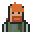 | 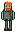 | Breach | Initiator |   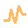  |
| 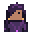 | 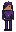 | Reyna | Duelist | 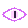 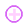  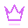 |
| 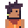 | 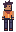 | Miks | Controller |     |
| 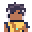 | 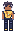 | Waylay | Duelist |  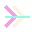   |
| 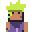 | 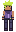 | Gekko | Initiator | 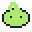   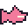 |
|  |  | Chamber | Sentinel | 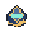 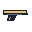 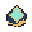  |
| 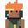 | 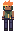 | Raze | Duelist | 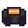 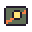 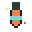 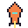 |
| 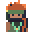 | 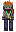 | Skye | Initiator | 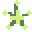 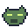 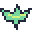 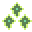 |
| 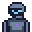 | 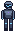 | KAY/O | Initiator | 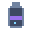 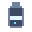 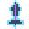 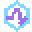 |
| 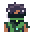 | 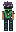 | Viper | Controller |   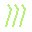  |
| 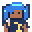 | 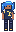 | Neon | Duelist |  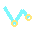   |
|  | 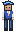 | Yoru | Duelist | 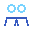 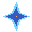   |
| 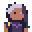 |  | Fade | Initiator |     |
|  |  | Harbor | Controller |     |
|  |  | Deadlock | Sentinel |     |
|  |  | Vyse | Sentinel |     |
|  |  | Iso | Duelist |     |
|  |  | Clove | Controller |     |
|  |  | Tejo | Initiator |     |
|  |  | Veto | Sentinel |     |
|  |  | Astra | Controller |     |
|  |  | Hush | Duelist |     |

### Weapons and armor

21 configured weapons, including melee.

| Category | Item | Sprite | Cost |
| --- | --- | --- | --- |
| Melee | Tactical Knife |  | Starting loadout |
| Sidearm | Classic |  | Free |
| Sidearm | Shorty |  | 300 credits |
| Sidearm | Frenzy |  | 450 credits |
| Sidearm | Ghost |  | 500 credits |
| Sidearm | Bandit |  | 600 credits |
| Sidearm | Sheriff |  | 800 credits |
| SMG | Stinger |  | 1,100 credits |
| SMG | Spectre |  | 1,600 credits |
| Shotgun | Bucky |  | 850 credits |
| Shotgun | Judge |  | 1,850 credits |
| Rifle | Bulldog |  | 2,050 credits |
| Rifle | Guardian |  | 2,250 credits |
| Rifle | Phantom |  | 2,900 credits |
| Rifle | Vandal |  | 2,900 credits |
| Rifle | Warden |  | 2,900 credits |
| Sniper | Marshal |  | 950 credits |
| Sniper | Outlaw |  | 2,400 credits |
| Sniper | Operator |  | 4,700 credits |
| Heavy | Ares |  | 1,600 credits |
| Heavy | Odin |  | 3,200 credits |
| Armor | Light Armor |  | 400 credits |
| Armor | Regen Shield |  | 650 credits |
| Armor | Heavy Armor |  | 1,000 credits |

<!-- END GAME CONTENT -->

## Roadmap

- [ ] Playtest Ascent with a full lobby and verify heights, windows, props and destructible cover. [Ascent design notes](docs/design/ASCENT.md)
- [ ] Verify ability animations and FX in a match for every active agent.
- [ ] Add rear and side character sprites for the active agents. [Figure views](docs/design/FIGURE_VIEWS.md)
- [ ] Check weapon sprites in hand, in the HUD and in the buy menu during a match.
- [ ] Tune gameplay and bot balance on the playable maps.
- [ ] Verify internet play across two separate networks.

See the [detailed roadmap](roadmap.md) and [sprite handover](docs/SPRITES.md).

## Development

- [Configuration](config/README.md) and [modding guide](docs/MODDING.md)
- In a checkout with the README generator, run `python -m tools.update_readme` after changing the roster, maps, weapons or sprites.
- Run the tests with `python -m pytest tests`.
- Build for Windows with `python build.py`. The game executable is `dist/Val2d/Val2d.exe`.

The VALORANT mark is by Riot Games. [VALORANT Asset Kit](https://playvalorant.com/en-gb/news/game-updates/valorant-asset-kit/)
